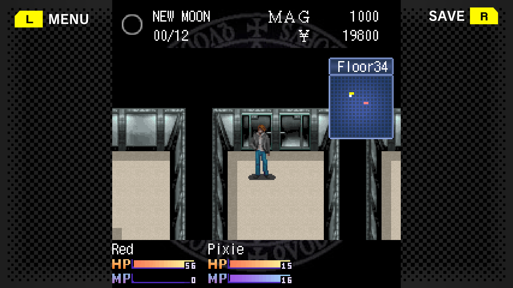
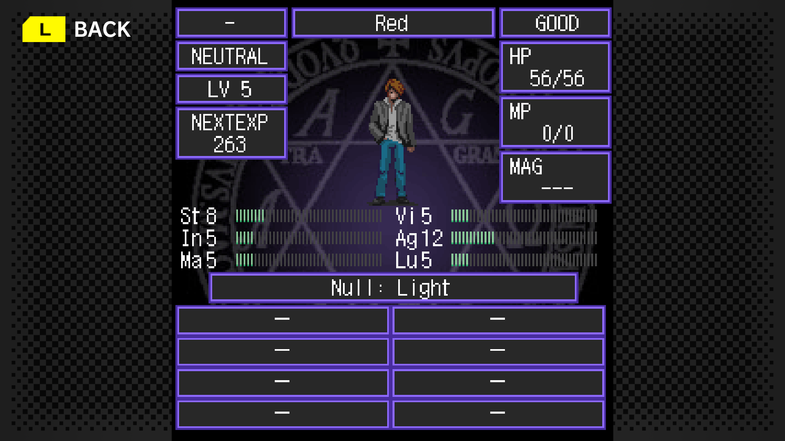
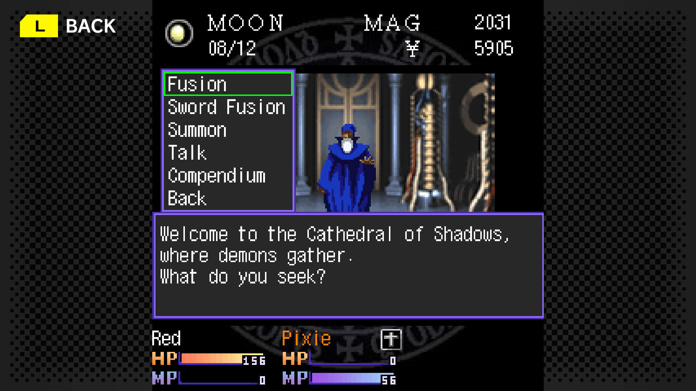
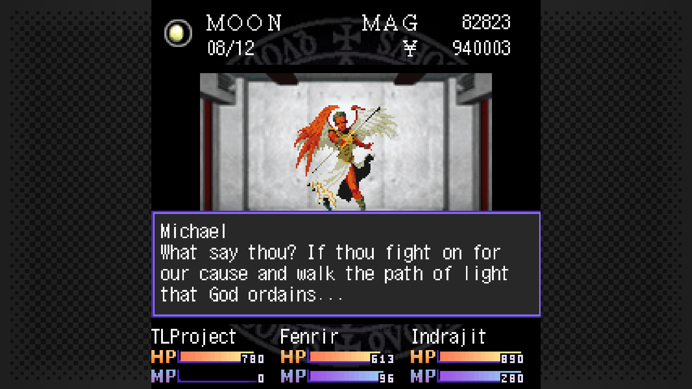
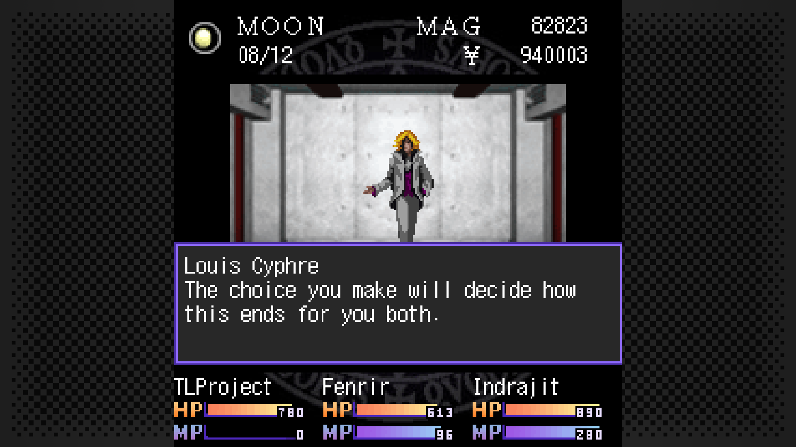
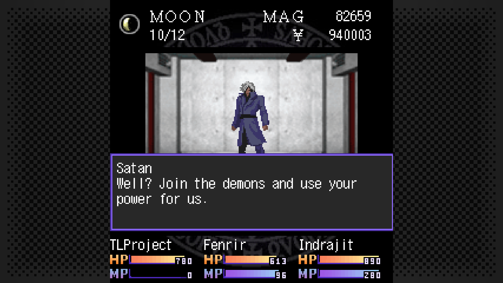

# Shin Megami Tensei: Tokyo Requiem — English Patch

A complete fan translation/localization of **G-MODE Archives+ Shin Megami Tensei: Tokyo Requiem** (真・女神転生 東京鎮魂歌) on Steam, a 2007 ATLUS mobile RPG that was never released in English.

It's a mod for your own copy of the game. **The game is not included**, and you need to [own it on Steam](https://store.steampowered.com/app/3713410/).



## What's translated

- The full story: the prologue, all 7 chapters and all three endings
- Demon negotiation, including a different voice for each type of demon
- Battles, menus, shops, the Bar, the Infirmary and the Cathedral of Shadows
- Demon, item and skill names, following ATLUS's official English where a name has one
- G-MODE's title screen, settings, dialogs and name entry

| | |
|---|---|
|  |  |


| | | |
|---|---|---|
|  |  |  |

## Install

1. In Steam, right-click the game and choose **Manage > Browse local files**.
2. Download `TokyoRequiemEN-v0.1.zip` from [Releases](../../releases).
3. Extract everything in the zip into that folder. `winhttp.dll` should end up next to `megaten_requiem.exe`.
4. Start the game from Steam as usual.

Existing saves keep working.

### Linux and Steam Deck

This hasn't been tested. BepInEx normally needs this in the game's Steam launch options:

```
WINEDLLOVERRIDES="winhttp=n,b" %command%
```

## Uninstall

Delete `winhttp.dll`, `doorstop_config.ini`, `.doorstop_version` and the `BepInEx` folder. Your saves stay in the `save` folder and still work in the Japanese game. The `compendium` and `minitrail` files there are only used by this mod and can be deleted.

## Optional enhancements

These are additions to the original game. **All of them are on by default.** To change one, edit `BepInEx\config\tokyorequiem.en.cfg`, which appears after the first launch, and restart the game.

| Setting | What it does | Default |
|---|---|---|
| `ShopItemDescriptions` | Shows a short description of the highlighted item in shops. The original has none. | `true` |
| `ReviveKeepsMP` | Revived allies keep their MP instead of dropping to 0. | `true` |
| `DemonCompendium` | Adds a Compendium to the Cathedral. It records a party demon's level, stats and skills so you can summon that version again. | `true` |
| `CompendiumCostScalesWithLevel` | Recorded demons cost more MAG the higher their recorded level. | `true` |
| `NoSpellFlash` | Replaces the full-screen white flash on spells with the physical-attack animation. | `true` |
| `NoSummonAlignmentLimit` | Lets Law and Chaos demons be summoned together. The MAG cost still applies. | `true` |
| `MinimapTrail` | Colors the minimap tiles you've walked on. Saved with your game. | `true` |
| `MinimapTrailColor` | Trail color, as RRGGBB hex. | `6084DC` |
| `ExpMultiplier`, `MoneyMultiplier`, `MagMultiplier` | Multiply battle rewards, from 1 to 100. 1 is the original balance. | `1` |

With the keyboard, Z confirms, X cancels, the arrow keys move and Q opens the menu. Controllers work as usual.

## Known limitations

- Text baked into images is still Japanese: the title logo and the How to Play pages.
- Some long item names sit tight against the item count in the shop and equipment screens.
- The story was played through in game on the Neutral path, other endings untested.
- Linux and Steam Deck are untested.

## Troubleshooting

- **The game is still in Japanese:** check that `winhttp.dll` is next to `megaten_requiem.exe`. On Linux, also set the launch option above.
- **Reporting a bug:** open an issue with a screenshot and attach `BepInEx\LogOutput.log`. For untranslated text, also attach `BepInEx\plugins\TokyoRequiemEN\untranslated.txt`, which lists any Japanese line the game drew without a translation. Choice menus can appear there even when translated, because their English keeps the Japanese "・" bullet.

## How it works

The game's files are never modified. [BepInEx](https://github.com/BepInEx/BepInEx) loads a plugin at startup, and the plugin uses [Harmony](https://github.com/BepInEx/HarmonyX) patches to swap text as the game draws it.

- **Text lookup:** the tables in `strings/` map each Japanese line to its English, so the Japanese is needed as the lookup key.
- **Names:** demons, items and skills are replaced by ID.
- **Story events:** these are bytecode scripts. The plugin reads each string at the script's current offset, looks up the English, and wraps it to fit the 240×240 screen.
- **Hot reload:** edits to the deployed tables apply about a second after saving, with no restart.

## Building

You need the [.NET SDK](https://dotnet.microsoft.com/download) and a copy of the game with BepInEx 5 installed.

```
dotnet build plugin -c Release -p:GameDir="<game folder>"
dotnet build plugin -c Release -p:GameDir="<game folder>" -p:Deploy=true
```

The second command also copies the plugin and tables into the game. To run the plugin's self-test, copy `tests/selftest.tsv` next to the deployed DLL; results go to the BepInEx log.

To build the player zip from the repository root:

```
python tools/release/package_release.py "<game folder>" plugin/bin/Release/TokyoRequiemEN.dll <BepInEx LICENSE> TokyoRequiemEN-v0.1.zip
```

## Development tools

These are the scripts used to work out how the game stores its data and to check the changes. They work on your own copy of the game, and no game data is included here. They need Python 3; the bundle tools also need [UnityPy](https://github.com/K0lb3/UnityPy). Each script explains its usage at the top.

| Folder | Tool | Purpose |
|---|---|---|
| `tools/extract` | `dump_bundles.py` | Export TextAssets from the game's Unity bundles |
| | `unpack_chapters.py` | Unzip the chapter archives into maps and event scripts |
| | `find_sjis.py`, `sjis_scan.py`, `grep_bundles.py` | Find Japanese text in binaries and bundles |
| | `walk_table.py` | Walk fixed-size records outward from a known name |
| `tools/decompiled` | `jp_literals.py`, `literal_inventory.py`, `concat_lines.py` | Inventory Japanese strings in decompiled C#, including lines built by concatenation |
| `tools/events` | `disasm.py` | Dump all text from the event bytecode |
| | `event_flow.py` | Show the control flow: flags, jumps, choices, battles and alignment changes |
| `tools/maps` | `map_summary.py`, `map_view.py` | List floors and draw them as text, with stairs, camps and event tiles |
| | `reach.py` | Flood-fill a floor to find which events can't be skipped |
| `tools/data` | `demon_records.py`, `item_records.py` | Dump demon and item records |
| | `save_info.py` | Read a save's chapter, level and alignment |
| | `gen_item_desc.py` | Generate equipment descriptions from item data |
| `tools/checks` | `check_events.py` | Confirm every story line has a translation and fits its box |
| | `check_item_desc.py` | Confirm item descriptions fit in two lines |
| `tools/testing` | `pad.py`, `contact_sheet.py` | Send virtual controller input and build screenshot sheets |
| `tools/release` | `package_release.py` | Build the player zip |

### Format notes

- **Event opcodes:** the length table is in `MegatenCanvas.Event_GotoStep`. Op 6 is a text box, 31 is full-screen narration and 43 is a choice menu. Jumps are relative.
- **Demon records:** 48 bytes each in `megaten001.bin`, with demon N's name at `0xA336 + N × 48`. Skills use 24-byte records and items use 30.
- **Text encoding:** Shift-JIS. The game's font draws `\` as ¥ and `~` as an overline.
- **Endings:** the hero's hidden alignment runs from -100 to 100, and it picks the ending when you reach the final scene.

## Credits

- **Original game:** ATLUS. Archives+ release: G-MODE.
- **Translation direction and playtesting:** Redeted
- **Plugin, tools, UI and system text:** Claude (Anthropic), via Claude Code
- **Story and negotiation drafts:** Original draft made with Gemini 4 Argon, reviewed against the japanese and its literal translation by Claude Opus 5.5, in-game review and cleaning by myself.
- **Mod loader:** [BepInEx](https://github.com/BepInEx/BepInEx) (LGPL-2.1, license included in the zip) and [HarmonyX](https://github.com/BepInEx/HarmonyX)

## Legal

This is an unofficial, non-commercial fan translation. It is not affiliated with or endorsed by Atlus, G-MODE or any rights holder; *Shin Megami Tensei: Tokyo Requiem* and all related names and assets belong to their respective owners. Please support the official release.

- The repository and the release zip contain **no game files**: the patch only works on a copy of the game you own on Steam.
- `strings/*.tsv` list the original Japanese script lines next to the English text, because the plugin uses them to look up each line. They are quoted for the purpose of the translation only.
- Do not commit game binaries, extracted game data, saves or decompiled code to this repository.

The plugin, tools and translation text written for this project are released under the [MIT licence](LICENSE). BepInEx is licensed separately under the LGPL-2.1.
